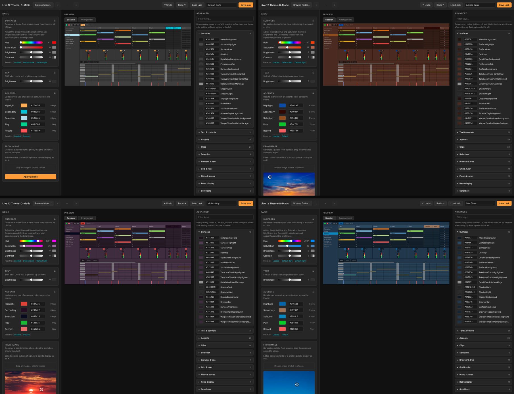

# ableton-theme-o-matic

A single-file browser editor/generator for Ableton Live 12 `.ask` themes. Open the HTML in any browser - nothing to install, no build, works offline.

Instead of hand-editing ~290 raw colour keys, it drives the whole UI from a handful of HSV relationships and keeps every key editable underneath.

*Top-left: a stock dark theme. The other three are generated from photos (source shown in each panel).*

---

## usage

- Open `ableton-theme-o-matic.html` in a browser
- **Load .ask** a theme, or **Browse folder** to step through a folder of them
- Edit, then **Save .ask** - writes back in Live's exact format (byte-identical round-trip)
- Drop the saved file in Live's Themes folder (the `ableton-themes-installer` tool in this repo restores them after an update)

---

## what it does

- **Basic** - Surfaces (hue, saturation, brightness, contrast), Text, and Accents drive the whole UI at once. Surfaces are one base colour plus a lightness ladder derived from the loaded theme, so a neutral grey still tints cleanly and inter-key relationships hold
- **Advanced** - every key, grouped and ordered by how often it actually changes across the stock themes; near-constant keys and VU meters sit at the end
- **Live preview** - Session and Arrangement views, MIDI/Audio/Device detail, mixer, browser and transport. Click any element to jump to its key
- **From image** - generate a palette from a photo: dominant tone tints the surfaces, vivid tones become accents, play/record stay hue-locked but borrow the palette's vividness. Drag the numbered swatches to re-sample; updates live

---

## notes

- **Save format** - Live rejects a theme whose tags aren't written exactly as it writes them; the editor matches that, so saved themes load without the red-track corruption a naive XML dump causes
- **Browser** - developed and tested in Firefox on macOS

---

Provided as-is. Back up your themes folder first.
